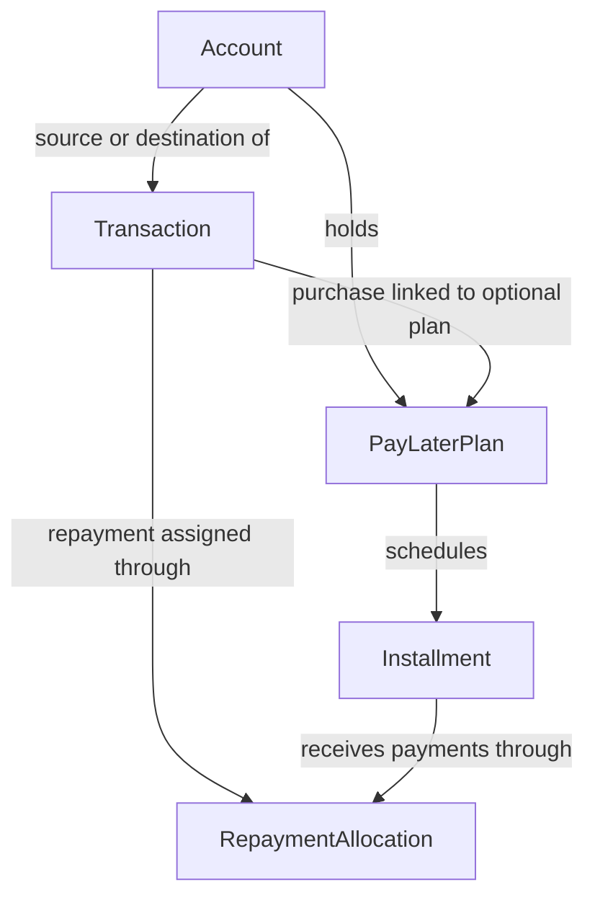

# Ledger behavior worksheet

## Working MVP — 17 October 2026

The implemented MVP uses two entities, `Account` and `Transaction`, with `INCOME`, `EXPENSE`, and `TRANSFER`. Purchases, fees, and money sent to other people use `EXPENSE`; card and PayLater repayments use `TRANSFER`. It tracks overall balances/debt, partial repayments, categories, and period summaries. See [README.md](README.md) for the actual API and run examples.

The plan/installment/allocation model below is a design for the later installment phase, not a requirement to create all five entities before using the MVP. The current account types are `BANK_ACCOUNT`, `CREDIT_CARD`, and `PAYLATER`.

This document records the agreed behavior and the future installment design. Its worksheets help check that the implementation matches your real spending.

## Rules already chosen

- Currency: MYR only for the first version.
- Track bank/wallet balances, credit-card debt, and outstanding PayLater debt as well as income and spending.
- Record every UOB and Maybank card charge.
- Break spending reports down by a small fixed category list.
- Enter starting balances and debts on a chosen ledger start date.
- Enter positive amounts; the record kind determines whether an amount adds to income or spending.
- A purchase counts as spending on its purchase date.
- Money sent to another person counts as spending on the transfer date.
- Record each original Shopee PayLater purchase, including its payment method and 1-, 3-, or 6-month plan. Count its spending on the purchase date. This replaces the earlier repayment-only reporting choice.
- PayLater repayments reduce PayLater debt and do not add spending again. A repayment funded with Amex also increases Amex debt.
- Support partial PayLater repayments and track which scheduled installments they pay toward.
- A later payment of the Maybank or UOB credit-card statement is not new spending if the card charges were already recorded.

## Proposed account model

`Account` represents a real bank account, wallet, credit card, or PayLater facility. It replaces the earlier proposed `PaymentMethod` model because you now want to track balances. A bank/wallet balance means money available; a credit-card/PayLater balance means money owed.

Suggested account fields: ID, name, account type, opening amount in sen, opening date, and active status. The opening amount is the balance immediately before the first new events on the chosen start date. Use a positive amount for money available or debt owed; account type supplies its meaning.

Opening amounts can be signed: a negative bank balance represents an overdraft, while a negative card debt represents credit owed to you. Ordinary transaction amounts remain positive.

`Transaction` represents one event. It can reference a source account and a destination account; one account can be referenced by many transactions. Its kind controls the effect on income/spending reports, while the account references control balance changes. Categories describe spending for your reports; they do not establish the bank's cashback eligibility.

Proposed transaction fields: ID, kind, positive amount in sen, event date, description, optional spending category, optional source account, optional destination account, and creation timestamp. A source bank/wallet account loses available money; a source credit-card/PayLater account gains debt. A destination bank/wallet gains money; a destination credit-card/PayLater account has debt reduced. The service validates which accounts are allowed for each event kind.

Examples of expected behavior:

- RM100 purchase on UOB: spending increases by RM100; UOB debt increases by RM100.
- RM100 payment from your bank account to UOB: bank balance decreases by RM100; UOB debt decreases by RM100; spending does not increase again.
- RM100 moved from your bank account to your own wallet: bank balance decreases and wallet balance increases; spending is unchanged.
- RM100 sent from your bank account to another person: bank balance decreases and spending increases, under your chosen rule.

Balances should be derived from opening amounts plus recorded events. Start without a second mutable current-balance field that can drift away from transaction history.

## PayLater plan and repayment model

Three additional entities are needed after ordinary account and transaction tracking works:

- `PayLaterPlan`: the agreed payment arrangement for a purchase. Links to its purchase and PayLater account; records the chosen 1-, 3-, or 6-month term and known fees. It is not a second spending record.
- `Installment`: one scheduled amount and due date under a plan. A three-month plan has three installments. Record the actual dates and amounts shown by the provider; do not assume purchase date plus one month or a fixed fee rate.
- `RepaymentAllocation`: how much of a repayment transaction is assigned to an installment. A repayment can cover several installments, and an installment can receive several partial repayments.

The relationships are: one purchase has at most one PayLater plan; one plan has many installments; a repayment transaction has many allocations; each allocation references one installment. Remaining installment amount is its scheduled amount minus its allocations, rather than a manually edited paid flag. If a transaction correction affects a repayment, its allocations must be checked in the same database transaction.

Example, with no fees and illustrative dates:

1. Buy an item for RM300 with PayLater on 14 October: spending +RM300 and PayLater debt +RM300. Create a three-month plan with three RM100 installments. The schedule itself adds no more debt or spending.
2. Repay RM60 using Amex: PayLater debt becomes RM240; Amex debt increases by RM60; no new spending. Allocate RM60 to the first RM100 installment, leaving RM40 due on that installment.
3. Repay the remaining RM40 using Amex: PayLater debt becomes RM200; the first installment is fully paid. Other Amex transactions are not shown in this example.
4. Pay RM100 from your bank to Amex: bank balance falls by RM100, Amex debt falls by RM100, and spending is unchanged.

All debt figures in this example assume zero opening PayLater debt. Fees, refunds, and other account changes must be recorded when present to keep balances aligned with the provider.

If a provider adds a financed fee, record its debt increase in the ledger and include the fee in the schedule. The schedule describes when that existing obligation is due; it must not create a second debt increase. The fee's posting date and reporting treatment should be agreed from a real bill before implementing this case.

For PayLater plans already outstanding at the start, enter their remaining schedules alongside the opening debt. These opening schedules do not create new spending or add the debt a second time. The total remaining schedules should reconcile to the opening PayLater debt, including known fees.

The repayment's exclusion from spending does not decide cashback eligibility. A qualifying Amex charge for that repayment can still earn a reward. Reward calculations use the actual card charge's date and classification.

## Category proposal

Start with dining, groceries, petrol, transport, shopping, bills, fees, and other. Categorize the original PayLater item, so its repayments do not need another expense category. Categories are fixed Java enum values; income and internal transfers do not need a spending category.

## Detailed field design for the five entities

This is a proposed model for you to implement gradually. Each entity has a table. Enums such as account type and spending category are values stored in columns, not additional entities.

Money fields ending in `Sen` use Java `long`: RM300.00 is `30000`. Keep API parsing in `BigDecimal`, then convert exactly. This uses SQLite integer storage rather than relying on its numeric affinity for decimal amounts. [SQLite datatype reference](https://www.sqlite.org/datatype3.html)

Use `Long` for generated IDs so a new entity can have a null ID before it is saved. Use `LocalDate` for ledger/due dates and `Instant` for creation timestamps. All fields are required unless marked optional. The mappings below are hints; write the entity classes yourself.

### 1. Account — where money or debt sits

Suggested table name: `accounts`.

- `id` — `Long`, generated primary key.
- `name` — `String`, for example `Maybank savings`, `UOB ONE Platinum`, or `SPayLater`.
- `type` — `AccountType` enum: `BANK_ACCOUNT`, `CREDIT_CARD`, or `PAYLATER`.
- `openingBalanceSen` — `long`, signed balance at the start of the ledger. Positive means available money for bank/wallet/cash accounts and money owed for card/PayLater accounts.
- `openingDate` — `LocalDate`, the date immediately before whose new recorded events the opening balance applies. Do not record older movements on top of a snapshot that already contains them.
- `active` — `boolean`, determines whether the account can be selected for new entries. Inactivating it preserves history.
- `createdAt` — `Instant`, when this account record was created.

An account can be referenced by many transactions and, for a PayLater account, many plans. `currentBalanceSen` and `currentDebtSen` are calculated query results, not separate mutable columns in this first design. Credit limits and statement-cycle settings can be added when the card-reward feature begins.

### 2. Transaction — one actual financial event

Suggested table name: `transactions`.

- `id` — `Long`, generated primary key.
- `kind` — `TransactionKind` enum: `INCOME`, `EXPENSE`, or `TRANSFER`. Purchases, fees, and person payments are expenses. A transfer to a PayLater account is a repayment; it can receive installment allocations when that feature is added.
- `amountSen` — `long`, strictly positive.
- `occurredOn` — `LocalDate`, when the financial event happened.
- `description` — `String`, such as `Shoes` or `SPayLater repayment`.
- `category` — optional `SpendingCategory` enum; required by service validation for spending events, absent for ordinary internal transfers.
- `sourceAccount` — optional `Account` relationship, mapped with `ManyToOne`. The database stores a `source_account_id` foreign key.
- `destinationAccount` — optional `Account` relationship, also `ManyToOne`, stored as `destination_account_id`.
- `createdAt` — `Instant`, when the backend saved it.

Add these when their features begin:

- `postedOn` — optional `LocalDate`, the bank's actual posting date; useful for statement-period reward calculations.
- `sourceMessageKey` — optional unique `String`, used to prevent duplicate Telegram events. If one message creates both a purchase and a fee event, each event needs a stable suffix on its key.

The service validates account roles: a purchase has a source; income has a destination; an internal transfer has two different accounts; a PayLater repayment has a funding source and a PayLater destination. Paying another person has a source account and no owned destination account.

Balance signs depend on account type: a source asset account loses money, a source debt account gains debt, a destination asset account gains money, and a destination debt account has debt reduced. This lets a single repayment row describe both sides of paying SPayLater with Amex.

### 3. PayLaterPlan — the arrangement attached to a purchase

Suggested table name: `paylater_plans`.

- `id` — `Long`, generated primary key.
- `account` — `Account` relationship, `ManyToOne`; must reference a `PAYLATER` account.
- `purchaseTransaction` — optional `Transaction` relationship, `OneToOne`, with a unique `purchase_transaction_id`. Required for a new purchase; absent for a pre-existing plan entered with opening debt.
- `termMonths` — `int`, one of `1`, `3`, or `6` for this version.
- `openingPlan` — `boolean`, identifies a remaining plan imported at the ledger start. It must agree with whether the purchase reference is absent.
- `scheduleStatus` — enum such as `DRAFT` or `CONFIRMED`. A draft means actual schedule details are still missing; it must not be displayed as a fully paid plan just because it has no installments yet.
- `providerReference` — optional `String`, an order or plan reference from the provider.
- `createdAt` — `Instant`.

For a new plan, its account must match the source account of its purchase. Ordinary non-PayLater purchases have no plan. `scheduledTotalSen`, scheduled fees, and remaining scheduled payments are calculated from its installments and allocations. A confirmed new plan has exactly `termMonths` installments. An opening plan may contain only installments still outstanding when the ledger begins.

### 4. Installment — one scheduled amount and due date

Suggested table name: `installments`.

- `id` — `Long`, generated primary key.
- `plan` — `PayLaterPlan` relationship, `ManyToOne`.
- `installmentNumber` — `int`, for example `1`, `2`, or `3` in a three-month plan.
- `dueDate` — `LocalDate`, taken from the actual provider schedule.
- `principalDueSen` — `long`, the portion of the purchase principal scheduled for this installment; nonnegative.
- `feeDueSen` — `long`, the known fee portion; nonnegative, zero only when there is genuinely no fee.

Make `(plan_id, installment_number)` unique. The number must fit the plan term. For a new confirmed plan, the sum of principal portions must equal the purchase amount; fee recognition also needs to agree with the provider's actual billing rules.

Calculate, rather than store independently:

- `amountDueSen = principalDueSen + feeDueSen`.
- `paidSen = sum of allocation amounts for this installment`.
- `remainingSen = amountDueSen - paidSen`.
- Fully paid when `remainingSen` is zero; overdue when it is positive and the due date has passed.

For opening plans, these scheduled portions represent what is still outstanding at the start, rather than adding past paid amounts again. A schedule never changes account debt by itself. Fee ledger events and the fee schedule must agree before nonzero fees are supported.

### 5. RepaymentAllocation — which installment a payment covers

Suggested table name: `repayment_allocations`.

- `id` — `Long`, generated primary key.
- `repaymentTransaction` — `Transaction` relationship, `ManyToOne`; must be a PayLater repayment.
- `installment` — `Installment` relationship, `ManyToOne`.
- `amountSen` — `long`, strictly positive.
- `createdAt` — `Instant`.

Make `(repayment_transaction_id, installment_id)` unique; combine amounts if one payment targets the same installment more than once. The repayment destination must match the installment plan's PayLater account. Allocations toward an installment cannot exceed its remaining amount, and all allocations from a repayment cannot exceed that repayment's amount.

Once fully assigned, allocation amounts must sum to the repayment amount. If the actual bill breakdown is not known yet, an unallocated remainder must be shown explicitly; do not guess which plan it paid. The account debt can still reflect the recorded payment, while the installment view waits for allocation.

This entity is necessary because one installment can receive several partial payments, and one payment can cover installments from several plans. Allocations do not change account balances or spending; their repayment transaction already did that.

## How the relationships work in Java and in the database

An entity field such as `Transaction.sourceAccount` references an `Account` object in Java. Its table column stores the account's ID, not a duplicated copy of all account fields. `ManyToOne` maps that relationship using a foreign key. Store enums with `Enumerated(EnumType.STRING)` so their names, rather than positions, are persisted. [Jakarta relationship documentation](https://jakarta.ee/specifications/persistence/3.2/apidocs/jakarta.persistence/jakarta/persistence/manytoone) · [Enum mapping documentation](https://jakarta.ee/specifications/persistence/3.2/apidocs/jakarta.persistence/jakarta/persistence/enumtype)

Logical relationships:

- One account has many transactions in either the source or destination role.
- One PayLater account has many plans.
- A purchase has zero or one plan; a new plan references one purchase.
- One plan has many installments.
- One repayment transaction has many allocations.
- One installment has many allocations.

You can begin with references on the child entities only. You do not need a bidirectional collection on every parent class; repositories can query children by their parent ID.

## Worked example with linked records

Assume SPayLater and Amex opening debts are zero and fees are zero. These IDs are illustrative:

1. `Account #1` is SPayLater; `Account #2` is Amex.
2. `Transaction #10` is an `EXPENSE`: `amountSen=30000`, source `Account #1`, no owned destination, category `SHOPPING`.
3. `PayLaterPlan #20` references `Account #1` and purchase `Transaction #10`, with `termMonths=3` and a confirmed actual schedule.
4. `Installments #31, #32, #33` reference plan #20. Each has `principalDueSen=10000`, `feeDueSen=0`, and its provider due date.
5. `Transaction #11` is a `TRANSFER`: `amountSen=6000`, source `Account #2`, destination `Account #1`.
6. `RepaymentAllocation #40` references repayment #11 and installment #31, with `amountSen=6000`.

Results: recorded spending RM300; SPayLater debt RM240; Amex debt RM60; first installment unpaid amount RM40. The other two installments remain RM100 each. The plan's remaining scheduled payments are RM240. No plan, installment, or allocation row adds another expense or another balance movement.

## Rules that keep the model consistent

- Save a purchase, its new plan, and its confirmed schedule atomically when they are supplied together.
- Save a repayment and its allocations atomically; if validation fails, do not leave half the operation saved.
- Use one service database transaction to perform the checks and writes. Repeated requests must not create repeated repayments or allocations.
- Ensure the schema has its foreign keys and unique constraints, and enable SQLite foreign-key enforcement for every app database connection. [SQLite foreign-key reference](https://www.sqlite.org/foreignkeys.html)
- Revalidate allocations when correcting a repayment amount; do not allow an earlier allocation total to exceed the corrected payment.
- Compare opening PayLater debt with its entered remaining plans. Flag missing plan detail instead of treating unrepresented debt as zero.
- Keep the purchase amount, payment amounts, and scheduled obligations as their own facts. Compute balances and paid status from them.

Implementation order: `Account` and its enum; refine `Transaction` and its enums; create/read an ordinary purchase and transfer; add `PayLaterPlan`; add `Installment`; add `RepaymentAllocation`. Build reward-rule entities afterward.

## Decisions still needed for installments

- How will the bot obtain actual first due dates, scheduled amounts, and fees from the purchase message or provider bill?
- When one payment covers multiple plans, should allocation be entered from the provider's bill breakdown or follow a confirmed ordering rule?
- What should happen to a schedule and earlier allocations when a purchase is refunded or cancelled?
- Which existing PayLater schedules will be entered at the ledger start date?

## Example format

For each example, write:

1. A message you might send to the Telegram bot.
2. The record kind and date the backend should store.
3. The MYR amount and source/destination accounts, if relevant.
4. How much it adds to income and spending totals.
5. How much each account's available balance or debt changes.
6. The reply you would expect from the bot.

**Filled fictional example — purchase**

- Message: “Bought lunch for RM12.50 with UOB ONE Platinum today.”
- Assume today is 11 October 2026. Store `PURCHASE`, date `2026-10-11`, amount `RM12.50` (`1,250` sen), description `Lunch`, payment method `UOB ONE Platinum`.
- Effect: income `+RM0.00`; spending `+RM12.50`.
- Account effect: UOB credit-card debt increases by RM12.50.
- Example reply: “Saved: lunch, RM12.50 spent with UOB ONE Platinum on 11 Oct.”

## Your examples to fill in

### Income

- Message:
- Stored kind, date, amount, and description:
- Effect on income and spending:
- Effect on account balances/debts:
- Expected bot reply:

### Money sent to another person

- Message:
- Stored kind, date, amount, recipient/description, and payment method:
- Effect on income and spending:
- Effect on account balances/debts:
- Expected bot reply:

### Original Shopee PayLater purchase and its later repayment

- Purchase message, amount, item category, and plan term:
- Purchase-date spending and PayLater debt effect:
- Scheduled dates, amounts, and any fees:
- Later repayment message, amount, and funding account:
- Installment(s) the repayment is allocated toward:
- Repayment effect on PayLater debt and the funding account:
- Expected replies:
- If you later pay the Maybank card statement, should that produce any additional spending? (The current rule says no.)

## Check your totals

Add the expense and income events in your examples together by hand. Exclude internal transfers and repayments:

- Total income: RM
- Total spending: RM
- Net (income minus spending), if you want the bot to show it: RM

The backend's date-range summary should eventually match these numbers for a range that contains all four dates.

## Questions to decide later

- If the user omits a date, should the bot assume today in `Asia/Kuala_Lumpur` or ask first?
- How should actual fees, refunds, and cashback credits be recorded and displayed in reports? These account changes must also be included to keep balances accurate.
- How should refunds and cancelled purchases change an existing entry or create a new one?
